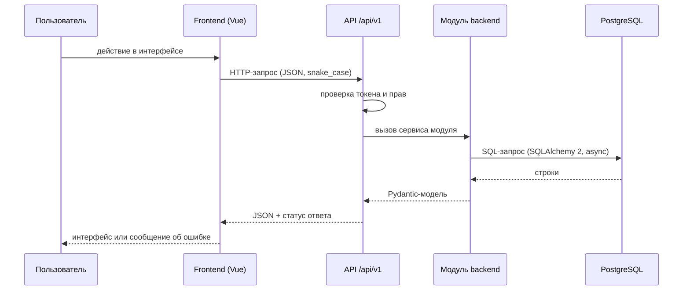

# Архитектурные решения

**Issue:** #5 (ARCH-01), исполнитель — техлид команды.
**Статус документа:** предложено техлидом. Действует для всей команды с момента merge в `dev`; изменения — только через новое Issue и согласование.
**Связано:** [Требования](../requirements.md) · [Контракт API](../api/openapi.yaml) · [Структура папок и локальный запуск](structure.md).

## Как читать документ

Каждое решение — запись вида ADR-номер + контекст + решение + следствия. Если задача не покрыта ни одной записью, это пробел: задай вопрос лиду, а не выбирай стек молча.

Решения, которые ещё требуют подтверждения, помечены статусом **требует подтверждения** и указанием, кто подтверждает.

---

## ADR-001. Монолит в одном репозитории (модульный)

**Контекст.** Команда из 18 человек, дедлайн первого спринта — 23 октября 2026. Нужно, чтобы frontend и backend запускались и проверялись вместе, но без микросервисов, сети между контейнерами и отдельных репозиториев.

**Решение.** Один репозиторий, один API-сервис, модульный монолит: модули (auth, users, universities, ads, forum) живут внутри одного приложения и общаются через внутренние сервисы, наружу — только через HTTP API по контракту.

**Следствия.**
- Нет отдельного «бэкенд-репозитория»: общий `docs/api/openapi.yaml` — единственный контракт.
- Модуль может быть вынесен в отдельный сервис позже, но до MVP это лишняя сложность.

---

## ADR-002. Frontend: Vue 3 + TypeScript + Vite

**Контекст.** В черновике `docs/architecture.md` предложен Vue 3 + TypeScript. FE-01 (Хапков) отвечает за каркас Vue-приложения.

**Решение.** Стек frontend:

| Часть | Выбор | Версия |
| --- | --- | --- |
| Язык | TypeScript, `strict: true` | 5.x |
| Фреймворк | Vue 3 (Composition API, `<script setup>`) | 3.5+ |
| Сборщик | Vite | 7.x |
| Маршрутизация | Vue Router | 4.x |
| Состояние | Pinia | 3.x |
| Линтинг | ESLint (flat config) + Prettier | ESLint 9, Prettier 3 |
| Окружение | Node.js LTS | 22.x |

**Следствия.**
- Версия Node фиксируется в `frontend/package.json` (`engines`) и в инструкции запуска.
- Состояние не дублируется в `localStorage` без нужды: сервер — источник истины, Pinia — кэш ответа.
- ESLint/Prettier — единые на весь `frontend/`, настройки лежат в `frontend/eslint.config.js` и `frontend/.prettierrc.json`.

**Статус:** требует подтверждения от FE-01 (Хапков) и API-01 (Косачев).

---

## ADR-003. Backend: Python + FastAPI

**Контекст.** В черновике `docs/architecture.md` предложен Python + FastAPI. BE-01 (Лаврецкий) отвечает за серверную часть.

**Решение.** Стек backend:

| Часть | Выбор | Версия |
| --- | --- | --- |
| Язык | Python, type hints обязательны | 3.12 (совместимость — 3.11+) |
| Веб-фреймворк | FastAPI | 0.115+ |
| Валидация данных | Pydantic v2 | 2.x |
| Конфигурация | pydantic-settings, значения из `.env` | 2.x |
| ORM | SQLAlchemy 2.x (async) | 2.x |
| Миграции | Alembic | 1.13+ |
| Драйвер БД | psycopg 3 | 3.x |
| Тесты | pytest + httpx | 8.x / 0.28+ |
| Линтинг | Ruff (форматирование и проверки) | 0.6+ |
| ASGI-сервер | uvicorn | 0.30+ |

**Следствия.**
- Ответы API собираются Pydantic-моделями из тех же схем, что описаны в `docs/api/openapi.yaml`: одно поле — одно имя на всех языках.
- Версия Python в CI — 3.12 (`/.github/workflows/checks.yml`); локально допустимо 3.11.
- FastAPI сам генерирует `/docs` и `/openapi.json` — это вспомогательный просмотр, **источник истины** остаётся `docs/api/openapi.yaml`.

**Статус:** требует подтверждения от BE-01 (Лаврецкий) и API-01 (Косачев).

---

## ADR-004. База данных: PostgreSQL + Alembic

**Контекст.** DB-01 (Коптелов) готовит схему и миграции; BE-01 подключает базу к приложению.

**Решение.** PostgreSQL 16 как единственная СУБД проекта, Alembic — единственный инструмент миграций.

**Следствия.**
- Одна схема на всё приложение, таблицы соответствуют модулям (`users`, `universities`, `ads`, `forum_*`).
- Миграции только через Alembic, ручной `CREATE TABLE` в проде недопустим; уже принятые миграции не переписываются, а меняются новой миграцией.
- UUID — идентификаторы всех сущностей, генерируются на стороне приложения (`uuid4`), в базе — `uuid` тип.
- Даты — `timestamptz`, в API — ISO 8601 UTC.
- ER-схема и правила связей живут в `docs/database/er.md` (DB-01).

**Статус:** требует подтверждения от DB-01 (Коптелов).

---

## ADR-005. Локальный запуск: Docker Compose для сервисов, npm для frontend

**Контекст.** DOCKER-01 (Аксютин) готовит `compose.yaml`, `backend/Dockerfile`, `.env.example`, `.dockerignore` и `docs/DOCKER_SETUP.md`.

**Решение.**
- PostgreSQL и backend запускаются через `docker compose up` (DOCKER-01).
- Frontend запускается локально через `npm run dev` — собирать фронтенд в Docker для учебного проекта дороже, чем нужно.
- Без Docker тоже должно быть возможно: backend поднимается через `uvicorn`, тесты работают на SQLite-совместимом/локальном PostgreSQL — зависимости фиксирует BE-01.

**Следствия.**
- В репозитории хранится только `.env.example` с плейсхолдерами. Реальные `.env`, пароли и токены — только локально, в `.gitignore`.
- Backend должен подниматься одной командой и отвечать на `GET /api/v1/health`.

---

## ADR-006. Контракт API: REST/JSON, единый источник истины

**Контекст.** В `docs/api/openapi.yaml` лежит черновик контракта; API-01 (Косачев) его согласует.

**Решение.** Контракт — `docs/api/openapi.yaml`. Формат и правила:

| Правило | Значение |
| --- | --- |
| Стиль | REST, JSON, UTF-8, без XML |
| Префикс | `/api/v1` |
| Имена полей | `snake_case` и в JSON, и в Python, и в TypeScript |
| Идентификаторы | UUID в строке |
| Даты | ISO 8601, UTC, например `2026-10-23T12:00:00Z` |
| Деньги | `price_rub` — целое число рублей или `null` |
| Список | JSON-массив, пустой список — `[]`, а не `null` |
| Ошибка | `{"code": "...", "message": "...", "details": {...}}` — `details` необязателен |
| Успех | `200` на чтение, `201` на создание, `400` на неверные данные, `401` без входа, `403` нет прав, `404` не найдено, `409` конфликт, `422` не прошла валидация, `500` внутренняя ошибка |

**Следствия.**
- Изменение пути, метода, поля, типа, статуса или формата ошибки — это изменение контракта: Issue → правка `openapi.yaml` → согласование (API, backend, frontend, БД, QA) → merge → правки в коде.
- Frontend и backend не «договариваются» о полях в переписке: если поля нет в контракте, его нет в интерфейсе.
- Контракт пока черновик: до его утверждения каждый модуль реализует только то, что уже описано в `openapi.yaml`, и не расширяет контракт сам.

**Статус:** требует подтверждения от API-01 (Косачев).

---

## ADR-007. Аутентификация: JWT, только хэш пароля

**Контекст.** BE-01 (Лаврецкий) делает регистрацию и вход; FE-02 (Юмина) делает форму входа.

**Решение.**
- Пароли хранятся только в виде хэша с солью (argon2 или bcrypt — выбирает BE-01). Открытые пароли, их варианты и «тестовые» пароли в Git не попадают.
- После входа backend выдаёт access token (JWT, TTL ~60 минут) в формате `{access_token, token_type: "bearer"}` — как в контракте.
- Клиент передаёт токен в заголовке `Authorization: Bearer <token>`. Где именно клиент его хранит — решение FE-01.
- Регистрация, вход и профиль — единственный участок, где backend работает с паролями; остальные модули получают уже готового пользователя.

**Следствия.**
- Проверка прав (401/403) — единый механизм backend, а не проверка в интерфейсе.
- Refresh token в первый релиз не входит; при необходимости — отдельное решение.

**Статус:** требует подтверждения от BE-01 (Лаврецкий) и FE-01 (Хапков).

---

## ADR-008. Границы модулей

**Контекст.** Главный риск команды — участники правят одни и те же файлы. Модули описаны так, чтобы каждый мог расширять свою часть, не задевая чужую.

**Решение.** Модули backend и их владельцы:

| Модуль | Содержит | Владелец |
| --- | --- | --- |
| `core` | конфигурация, общие ошибки, общие зависимости | ARCH-01 (каркас) → BE-01 |
| `api` | сборка роутера `/api/v1`, health | ARCH-01 (каркас) → BE-01 |
| `modules/auth` | регистрация, вход, токены, хэши паролей | BE-01 (Лаврецкий) |
| `modules/users` | профиль пользователя | BE-01 (по согласованию) |
| `modules/universities` | справочник вузов | BE-01 (по согласованию) |
| `modules/ads` | объявления, категории, фильтры | Backend-направление (BE-01 решает, кому) |
| `modules/forum` | разделы, темы, ответы | BE-02 (Минко) |
| `db` | подключение, сессии, модели, миграции | BE-01 + DB-01 (Коптелов) |

Модули frontend и их владельцы:

| Каталог | Содержит | Владелец |
| --- | --- | --- |
| `src/router` | маршруты приложения | FE-01 (Хапков) |
| `src/components` | переиспользуемые элементы, навигация | FE-01 (Хапков) |
| `src/views` | страницы: вход, объявления, форум, профиль | FE-02…FE-04 (Юмина, Дилеев, Шадунцев) |
| `src/api` | единственный способ вызова API и разбор ошибок | FE-01 (Хапков) + API-01 (Косачев) |
| `src/stores` | состояние Pinia | FE-01 (Хапков) |
| `src/styles` | общие стили, переменные, адаптивность | FE-01 + UI-01 (Никитин) |

**Следствия.**
- Правило: если задача твоя — добавляй файлы в свой каталог, а не правь чужой. Общий файл меняется только с согласования лида.
- Модуль не обращается к внутреннему устройству другого модуля: обмен — через сервисный слой модуля или через API-контракт.
- Если нужна новая папка или новый модуль — это изменение архитектуры, оно идёт через Issue (ADR-012).

---

## ADR-009. Схема взаимодействия

**Контекст.** «Схема взаимодействия» — один из критериев готовности ARCH-01. Ниже — как ходят данные от пользователя до базы и обратно.

**Решение.** Единый путь запроса:

Правила потока:
1. Frontend не знает про базу и не пишет SQL. Он знает только URL, метод, поля запроса и формат ответа.
2. Frontend не собирает JSON руками: типы запросов и ответов лежат в `frontend/src/api/types.ts` и повторяют схемы `openapi.yaml` один в один.
3. Backend не придумывает формат ответа: ответ — это Pydantic-модель, соответствующая схеме контракта.
4. Ошибка всегда в формате `{code, message, details}`; frontend показывает `message`, а `code` использует для ветвления (например, `401` → экран входа).
5. Список, у которого нет данных, — пустой массив `[]`; `null` допустим только там, где поле необязательное по контракту.

---

## ADR-010. Общие правила кода

**Решение.**

| Область | Правило |
| --- | --- |
| Backend | type hints на всех публичных функциях, аннотации в стиле `-> str \| None` |
| Backend | Ruff — форматирование (`ruff format`) и проверки (`ruff check`), конфиг в `backend/pyproject.toml` |
| Backend | pytest — тесты в `backend/tests/`, имя файла `test_*.py` |
| Frontend | TypeScript `strict`, без `any` без явной причины |
| Frontend | ESLint + Prettier, конфиги в `frontend/` |
| Frontend | `<script setup lang="ts">`, компоненты — `PascalCase.vue`, папки — `kebab-case` |
| Общее | линтер и форматтер запускаются до PR; результат — в описании PR |
| Общее | лицензионные файлы, `.env`, `node_modules`, `.venv`, логи и базы — не коммитим |

**Следствия.** Команда может собирать и проверять код одинаково; результат «прогнал линтер» воспроизводится у другого участника одной командой.

---

## ADR-011. Версионирование API

**Решение.** Префикс `/api/v1` фиксирует версию контракта. Ломающее изменение (удаление поля, смена типа, смена смысла поля) требует новой версии `/api/v2` и параллельной поддержки `/api/v1` хотя бы на один спринт. Добавление нового необязательного поля — не ломающее изменение, но требует Issue и обновления контракта.

---

## ADR-012. Что требует согласования

**Решение.** Без отдельного Issue и согласования нельзя:

1. менять публичный API (`docs/api/openapi.yaml`) — API-01 + BE-01 + FE-01 + DB-01 + QA;
2. менять таблицы и миграции — DB-01 + BE-01;
3. добавлять библиотеки, менять стек или структуру папок — техлид (ARCH-01);
4. менять формат ошибок, правила именования, способ аутентификации — техлид + API-01;
5. менять CI и правила репозитория — техлид + PM-01.

Порядок работы: Issue → правка документа-источника → согласование → merge в `dev` → реализация. Реализация не должна обгонять контракт.

---

## Открытые вопросы

| Вопрос | Кто решает | Когда |
| --- | --- | --- |
| Точные версии pinned-зависимостей backend и frontend | BE-01, FE-01 | до merge каркаса |
| Покрытие токена: argon2 или bcrypt | BE-01 | при реализации auth |
| Где фронтенд хранит access token | FE-01 | при реализации входа |
| Кто в backend ведёт модуль `ads` | BE-01 | до начала работы по объявлениям |
| Нужна ли пагинация и её формат в контракте | API-01 + PM-01 | до утверждения контракта |
| Категории объявлений в MVP | PM-01 (Ручкин) | до DB-01 |
| Версия PostgreSQL в `compose.yaml` (предлагается 16) | DOCKER-01 + DB-01 | при настройке Compose |

## Что уже решено в этом документе

Стек (ADR-001…005), правила контракта и взаимодействия (ADR-006, 009), аутентификация (ADR-007), границы модулей и владение каталогами (ADR-008), правила кода (ADR-010), версионирование (ADR-011), порядок согласований (ADR-012).
